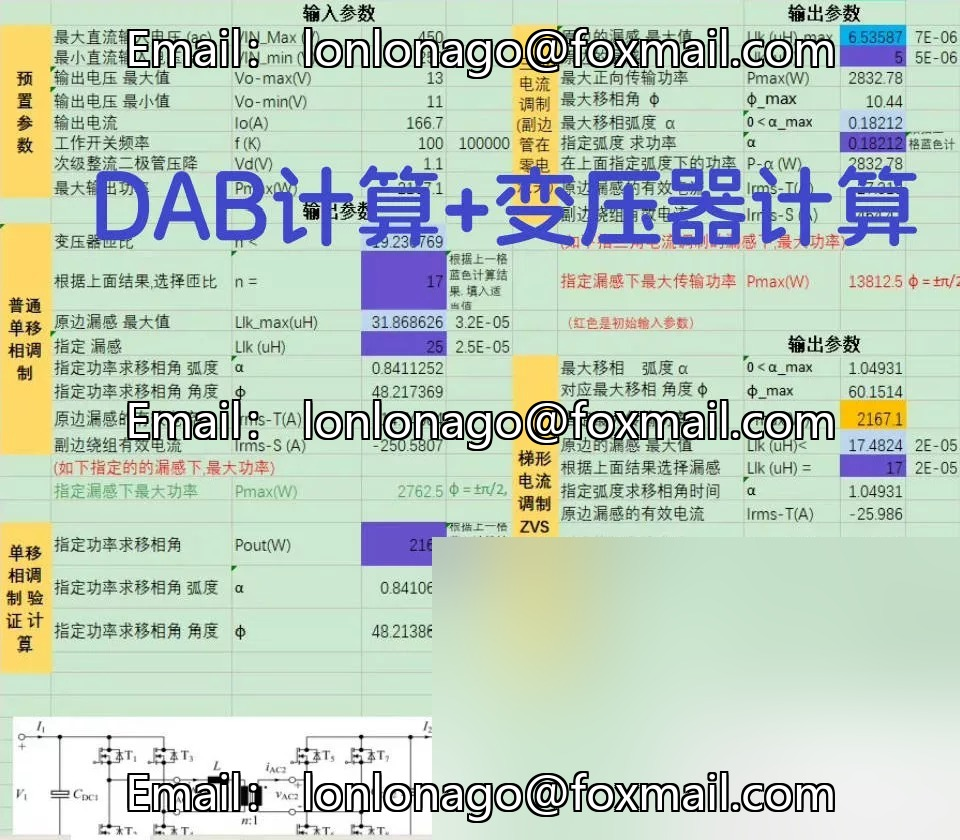
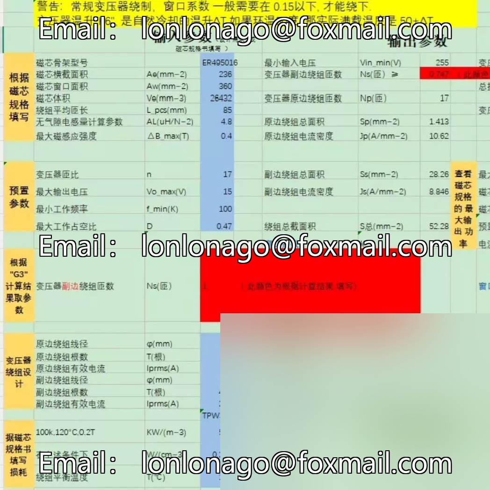

# DAB calculation plus transformer calculation

## Body

DAB computing + transformer computing, editable

DAB is a high-frequency, isolation-type dc-to-dc converter topology. Its core structure and characteristics are as follows:
1. Dual active: The converter uses full-control switching devices such as MOSFET and IGBT to build an active bridge arm topology on both the primary and secondary sides (common structures include full bridge and half-bridge), supporting bidirectional energy transmission.
2. Bridge: Refers to the bridge circuit structure adopted on the primary side and the secondary side.
3. High-frequency transformer: The two active bridges are connected via a high-frequency transformer, completing electrical isolation and voltage level matching; the working frequency of the transformer is usually tens of kHz to hundreds of kHz, which can significantly reduce the equipment volume.

online platform shipping, can be ordered directly

The content includes DAB high-frequency isolated DC-DC transformer calculations and transformer calculations with editable parameters, covering input/output parameters, maximum DC input voltage, output voltage, transmission power, leakage inductance, and turns ratio.

<!-- AI_ENRICHED -->

## Images

## Payment

Here is a pay link on Stripe ( https://buy.stripe.com/3cs8yP7sY87d0vu9AB ). Please contact me lonlonago@foxmail.com after funding $89, and I will send you a complete data files , thank you!

